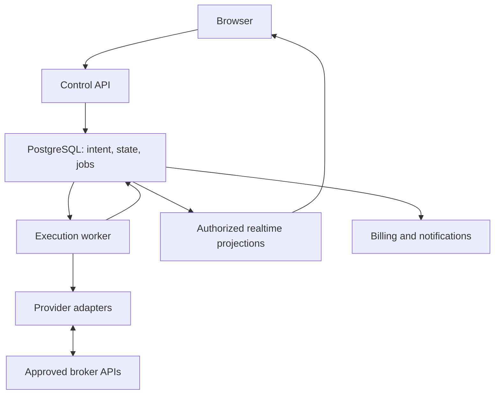

# System and repository architecture

## Decision

Use a modular monolith with two primary deployables: web/control application and execution worker. Start with PostgreSQL as durable operational storage and job transport. This limits distributed infrastructure while retaining strict module boundaries. Introduce additional queue infrastructure only after measured throughput or isolation needs justify it.

Recommended greenfield stack: TypeScript, React/Next.js for public and authenticated UI, supported Node LTS for the persistent worker, PostgreSQL, SQL migrations plus a thin typed query layer, and a managed OIDC authentication provider that supports MFA. Retain an adequate existing stack if Phase 0 finds one. Runtime versions and packages must be selected against current official documentation and locked during implementation; this document deliberately does not invent installed versions.

| Component | Responsibility | Forbidden responsibility |
|---|---|---|
| Web/control API | Identity, authorized configuration, operation requests, projections, billing webhook ingest | Direct broker trading, broker tokens in client bundles |
| Broker session module | Authentication, refresh, heartbeat, streaming, snapshot capture, provider limits | Product-level sizing decisions |
| Copier domain | Deterministic event-to-intent decisions and lineage | HTTP framework or UI dependencies |
| Risk domain | Limits, reservations, latches, admission decisions | Unrequested strategy selection |
| Account execution coordinator | Single writer, fencing, command sequencing, submission/recovery | Blind retry after ambiguous network result |
| Reconciler | Expected/actual comparison, discrepancy classification, recovery proposals | Unbounded position chasing |
| PostgreSQL | Intent ledger, projections, inbox, outbox, queue, leases, audit | Storing unencrypted credentials |
| Notification/billing processor | Durable notifications and entitlement projection | Blocking the trade path on external email or Stripe calls |
| Monitoring | Health, metrics, alert routing, incident evidence | Altering customer strategies |

Broker sessions, copier, risk, reconciliation, and dispatcher initially share a worker deployment. Keep notification/billing jobs on a separate low-priority loop with bounded concurrency; split into a utility worker before their workload can delay execution. Monitoring is independently hosted before beta.



The provider adapter isolates protocol differences, not their consequences: absent idempotency, stale snapshots, unsupported order types, and local-only order behavior must remain visible to the core through capability and quality metadata.

## Technology tradeoffs

- **Next.js/React:** suitable public site and interactive dashboard in one application. Keep domain code portable to another web framework. Do not embed copy loops in request handlers, React effects, server actions, or browser storage.
- **Node/TypeScript:** shared event contracts and good fit for I/O-bound streams. CPU-heavy simulation and analysis run outside the execution loop. If an approved Rithmic SDK mandates .NET/C++, add a narrow adapter sidecar; do not rewrite the core.
- **PostgreSQL:** transactions, constraints, row locks, and durable operational data. Queue workers may claim eligible rows using `FOR UPDATE SKIP LOCKED`, but account ordering is an additional invariant, not supplied by that query alone [S12].
- **Redis:** not required initially. Consider later for nonauthoritative fanout/cache/rate coordination. Losing Redis must never lose accepted trading intent, remove a kill latch, or create another order writer.
- **SSE:** adequate for server-to-browser status; mutations use authenticated HTTP commands. WebSockets remain provider-facing as required. Choose browser WebSockets later only if interaction or scale requires them.
- **Billing:** Stripe Billing/Checkout/Portal is a candidate, subject to business acceptance; hide provider details behind a billing service [S10–S11].
- **Hosting:** persistent paid containers/VMs for execution and managed PostgreSQL. Static GitHub hosting cannot run this copier. Reference production deployment uses AWS ECS/Fargate and managed PostgreSQL; simpler persistent container hosting can serve preproduction if it passes the same requirements [S14].

Do not add Kafka, Kubernetes, event-sourcing frameworks, a fleet of microservices, or multi-region active/active execution to the initial build.

## Concurrency and ownership

Scope serialization to canonical follower account, across all connections, not just a group or instrument. Lock group/config and shared risk scopes in deterministic order, then account scope. Use short database transactions to reserve exposure, create intent, and advance state atomically. Do not hold a transaction open across a broker request.

One session owner per provider login/connection maintains subscriptions; one execution owner per canonical account authorizes outbound commands. The two responsibilities may share a process. Provider-wide quotas are shared across that login, not multiplied by each follower.

Lease epochs are checked immediately before dispatch and persisted on every attempt. However, a database lease cannot revoke a broker request already in flight. If the previous writer may still be alive, fence its outbound network/session or confirm process termination before a replacement sends. Otherwise remain halted and reconcile. Avoid automatic takeover merely because a clock-based lease expired. See `DEPLOYMENT.md`.

## Proposed tree — adopt incrementally

```text
TradeCopierWebsite/
  CLAUDE.md
  .gitignore
  .dockerignore
  .agents/skills/                 local only; never package or track
  apps/
    web/                         site, dashboard, control API, SSE
    worker/                      sessions, account coordinator, job runners
  packages/
    domain/                      copier, risk, state machines, reconciliation
    contracts/                   normalized types and validation schemas
    broker-adapters/
      simulated/
      tradovate/
      ninjatrader/                only when separately approved
      rithmic/                    only when separately approved
    database/                    queries, migrations, constraints
    security/                    authorization, secret-service interfaces
    observability/               redaction, metrics, trace helpers
    ui/                          shared UI primitives when useful
  tests/
    scenarios/                   deterministic replay and fault fixtures
    contracts/                   provider conformance suites
    e2e/
  infra/                         deployment and environment templates
  docs/                          specifications and decisions
    adr/
    runbooks/
    evidence/                    sanitized certification reports only
```

This is a target organization, not an instruction to move existing files. An existing single application can preserve its tree while adding equivalent modules. Do not scaffold empty integrations that pretend to be available.

`docs/REPO_AUDIT.md` records observed stack, tracked files, branch, local skills metadata, runnable commands, test baseline, existing features, and differences from this plan. It must not copy skill contents or secrets. ADRs record changed design assumptions and affected tests. Provider agreements and credentials belong in restricted business storage, never the public repository.

## Control API contract

Versioned HTTP resources: `/api/v1/connections`, `/accounts`, `/copier-groups`, `/operations`, `/activity`, `/risk-profiles`, `/billing`, `/notifications`. Command endpoints include `/copier-groups/{id}/activate`, `/pause`, `/resume`, `/halt`, and `/flatten`. A group flatten targets followers only by default; explicitly label any separately authorized account-level leader action.

Mutation request: validated payload, `Idempotency-Key`, expected configuration version, authenticated principal. Persist request hash with the key; reuse with a different payload returns 409. Configuration conflicts return 409; unavailable provider capabilities return 422 with reasons; auth failures return 401/403. Async actions return 202 with operation ID and per-account status. Read models include `asOf`, freshness, source, environment, and known limitations. Never accept a tenant ID as proof of authorization.

Activation is an atomic transition that claims memberships and freezes settings after preflight. A web response must not claim that broker reconciliation has finished before it has. No general-purpose arbitrary order-entry endpoint is included in V1.
